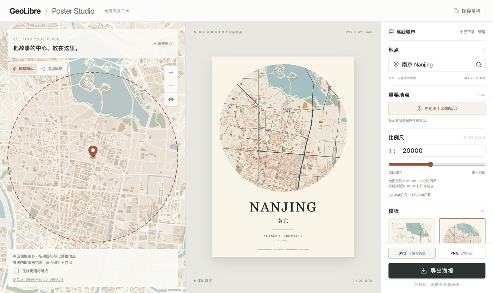

# GeoLibre Poster Studio

Create editable city map posters in [GeoLibre](https://github.com/opengeos/GeoLibre), with a live map picker, print-scale control, custom colors, place markers, and offline vector data.

[中文说明](README.zh-CN.md) · [Downloads](https://github.com/CUGbaoyi/geolibre-poster-studio/releases)



## Install

Requires GeoLibre 3.3.0 or newer. Download `poster-studio-0.5.0.zip` from Releases, then choose **Settings → Manage Plugins → Install from file**. Activate **Poster Studio · 地图海报** under **Plugins → Installed**. The editor opens on activation and can be reopened from the **Poster Studio** menu.

The interface is currently in Chinese. Marketplace submission is pending; ZIP installation is available independently of registry approval.

## Features

- City linework and circular neighborhood prints, with four palettes and individual paper, land, water, green space, road, building, and text colors.
- Pick the center on an interactive map and preview the matching poster extent. Add up to 30 named markers with editable symbols, colors, and label positions.
- A3, A4, and square paper, with a numerical print scale from 1:5,000 to 1:40,000. Scale is calculated at the map center and assumes printing at 100% of the selected paper size.
- Editable vector SVG and 300 dpi PNG export, including print-density metadata and OpenStreetMap attribution.
- Local drafts, GeoLibre project state, and a separate IndexedDB library of offline city data. Completed city packages persist across reloads.
- An embedded Nanjing sample that works without external map requests. MapLibre, its worker, CSS, and fonts are bundled; runtime CDN dependencies are not required.

## Offline city packages

Open **离线城市 → 导入离线包**, select a `.poster-city.zip`, then choose **使用此城市**. Within its coverage, changing the poster center and scale uses local vector data. The importer verifies tile sizes, SHA-256 hashes, geometry, coverage, and metadata before writing the package in one IndexedDB transaction. Hashes detect corruption; they are not publisher signatures.

The separate `suzhou-40km.poster-city.zip` release asset covers a 40 × 40 km rectangle centered at 120.6200° E, 31.3100° N. It contains 100 tiles and 87,271 distinct OSM features, from the Jiangsu extract dated 2026-10-11. This covers the city center and surroundings, rather than the entire administrative municipality. The asset is about 8.5 MB; its adjacent report records provenance, bounds, and checksums.

Plugin ZIPs and city ZIPs have different purposes. Raw `.osm.pbf` files must first be converted. Import limits are 64 MiB compressed, 256 MiB expanded, and 1,024 tiles. Data is stored per browser and origin; storage limits and clearing site data affect the offline library.

For rebuilding city packages from PBF, see the commands in [中文说明](README.zh-CN.md#从江苏-pbf-重建苏州包). The converter preserves complete geometries and polygon holes when assigning features to spatial tiles, and records repair diagnostics.

## Network behavior

Explicit place searches use Nominatim. Fetching vector data outside local coverage uses public Overpass services, with bounded waits, cancellation, retry, and incomplete-data feedback. The optional street-label basemap uses OpenStreetMap raster tiles only when enabled. City downloads support pause/resume; public services can be slow or unavailable. No API key is required.

Exports are disabled while the requested extent is incomplete. Data coverage and detail depend on OpenStreetMap. The offline package does not include searchable address data or offline raster basemap tiles.

## Develop

Use Node.js 22.12+ and install the pinned dependencies:

```sh
npm ci
npm run dev
```

The preview runs at `http://127.0.0.1:4173/`. Build and test:

```sh
npm run build
npm run typecheck
npm test
```

Build outputs are `dist/index.js`, `dist/plugin.json`, and `artifacts/poster-studio-0.5.0.zip`. The ZIP includes licenses, the sample database, and a catalog screenshot. The optional actual-host ZIP compatibility test runs when `GEOLIBRE_CHECKOUT` points to a GeoLibre source checkout with its dependencies installed:

```sh
GEOLIBRE_CHECKOUT=/path/to/GeoLibre npm test
```

The regression suite covers geometry and holes, escaping, drafts, markers, paper/latitude scale calculations, loading cancellation, offline download resumption, package validation, atomic storage, PNG density, release metadata, and plugin lifecycle cleanup. The optional Python converter test requires Pyosmium and Shapely.

Browser checks have exercised the standalone editor, offline import and persistence, center/scale changes with external map requests blocked, and SVG export. Native Tauri and other browsers have not been fully validated. SVG text uses fonts available on the receiving device; PNG captures the rendered appearance.

## License and attribution

Source code: [MIT](LICENSE). Vendored code and dependencies retain their licenses under `src/vendor/` and in the release ZIP. The OSM conversion module derives from GeoLibre, copyright Qiusheng Wu.

Map data: © [OpenStreetMap contributors](https://www.openstreetmap.org/copyright), [ODbL 1.0](DATA-LICENSE.txt). The Nanjing sample database is included in the ZIP; exports retain attribution. City packages include their own provenance and license metadata. Data snapshot dates and local acquisition dates are recorded separately.

Visual references include [MapToPoster](https://github.com/originalankur/maptoposter), prettymaps, and Mapiful. Fonts and icons include IBM Plex Sans and Lucide.
